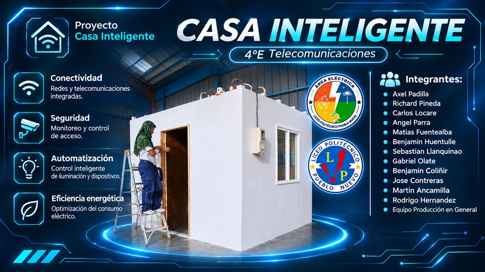
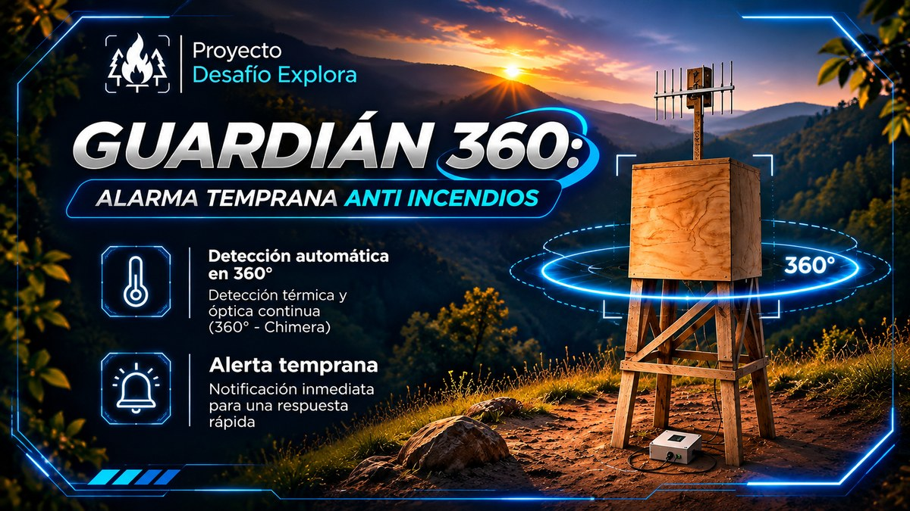
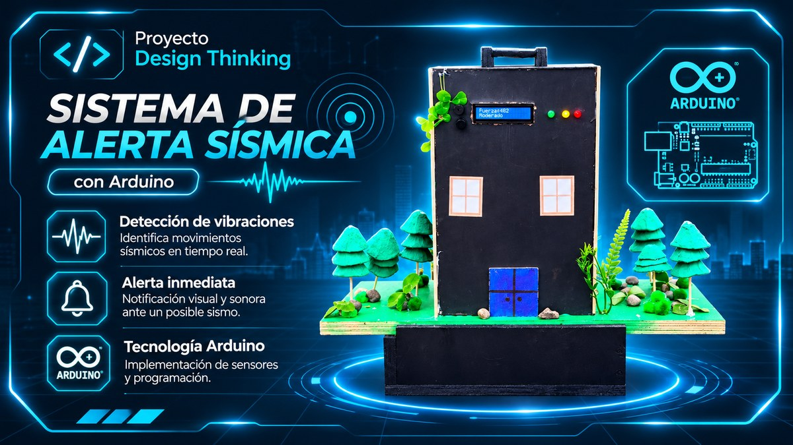

# Richard Pineda

### Técnico en Telecomunicaciones de Nivel Medio | Redes y Networking

**Lautaro, Región de La Araucanía, Chile**

*Aprender · Crear · Conectar*

---

## 👨‍💻 Sobre mí

Soy estudiante de la especialidad de **Telecomunicaciones y Redes** en el **Liceo Politécnico Pueblo Nuevo**. Me interesan especialmente el **networking**, la conectividad, la electrónica y las soluciones tecnológicas aplicadas a problemas reales.

Me considero una persona **responsable, dedicada y colaborativa**, con disposición para aprender, trabajar en equipo y desarrollar nuevas habilidades. He participado en proyectos académicos relacionados con redes, cámaras de seguridad, telefonía IP, Arduino, electricidad y mantenimiento de computadores.

Mi objetivo es **seguir formándome, obtener certificaciones y adquirir experiencia práctica** en el área tecnológica.

## 🛠️ Conocimientos técnicos y herramientas

### Redes y telecomunicaciones

- Configuración de redes y conectividad.
- Cableado, montaje de rack y fundamentos eléctricos.
- Sistemas de videovigilancia (**CCTV**) y telefonía IP.

### Sistemas y plataformas

También realizo instalación de sistemas operativos y mantenimiento y armado de computadores.

### Programación y desarrollo (conocimientos en formación)

### Software y herramientas técnicas

## 🚀 Proyectos destacados

### 🏠 Casa Inteligente

Proyecto académico de vivienda demostrativa con **redes, cámaras de seguridad, telefonía IP, televisión satelital, sensores e instalación eléctrica**. Participé en la elaboración de planos, instalación eléctrica, armado del rack y configuración de la red, además de colaborar en distintas etapas del proyecto.

**Áreas:** Redes · Electricidad · CCTV · Telefonía IP · Arduino · ProfiCAD  
**Estado:** Finalizado

### 🌲 Guardián 360 | Desafío Explora

Propuesta tecnológica para la **detección temprana de incendios en zonas rurales de La Araucanía**. Colaboré en una aplicación web destinada al monitoreo de cámaras. El proyecto fue presentado en una instancia universitaria.

**Áreas:** Desarrollo web · Monitoreo · Tecnología ambiental  
**Estado:** Prototipo

### 📟 Sistema de alerta sísmica | Design Thinking

Construcción de una maqueta con **sensores de vibración y alertas visuales** para representar un sistema de detección sísmica. Participé en el armado del circuito y en la programación asistida del prototipo.

**Áreas:** Arduino · Sensores · Electrónica · Programación  
**Estado:** Finalizado

## 🎓 Formación académica

| Período | Institución | Formación |
|---|---|---|
| 2023–2026 | Liceo Politécnico Pueblo Nuevo | Enseñanza media técnico-profesional: Telecomunicaciones y Redes |
| 2015–2022 | Liceo Los Castaños | Enseñanza básica |

**Formación complementaria:** Telecomunicaciones Conectado.

## 🏅 Participación y reconocimientos

- **WorldSkills, Redes TI:** participación en competencia técnica de redes.
- **Desafío Explora:** participación en propuesta tecnológica.
- **Mejor Compañero:** diploma de reconocimiento escolar.
- **Primeros Auxilios Psicológicos:** diploma de Orientador de Primeros Auxilios Psicológicos.
- **Reconocimientos escolares:** desempeño académico, compañerismo, compromiso y responsabilidad.

### 📚 Aprendizaje en curso

- Formación en **ciberseguridad**.
- Preparación para la certificación **Cisco CCST**.

> Estos estudios se encuentran en desarrollo y no se presentan como certificaciones obtenidas.

## 📫 Contacto

- **Correo:** [richardpineda.lppn@gmail.com](mailto:richardpineda.lppn@gmail.com)
- **Ubicación:** Lautaro, Región de La Araucanía, Chile.
- **Currículum:** [Ver PDF](assets/cv/Curriculum_Richard_Pineda.pdf)

---

**Gracias por visitar mi portafolio.**  
*Tecnología, aprendizaje continuo y compromiso con cada proyecto.*

